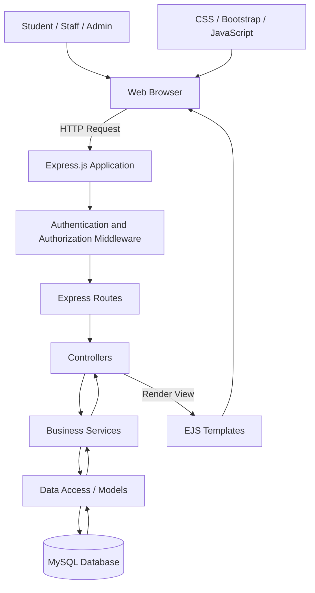
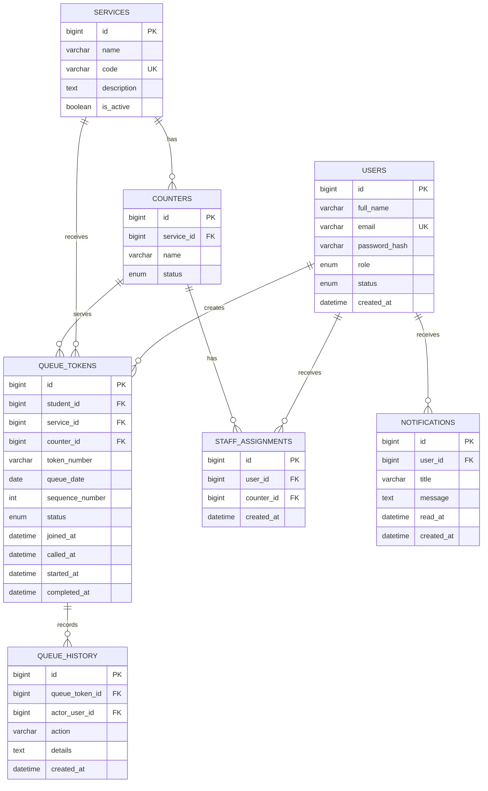
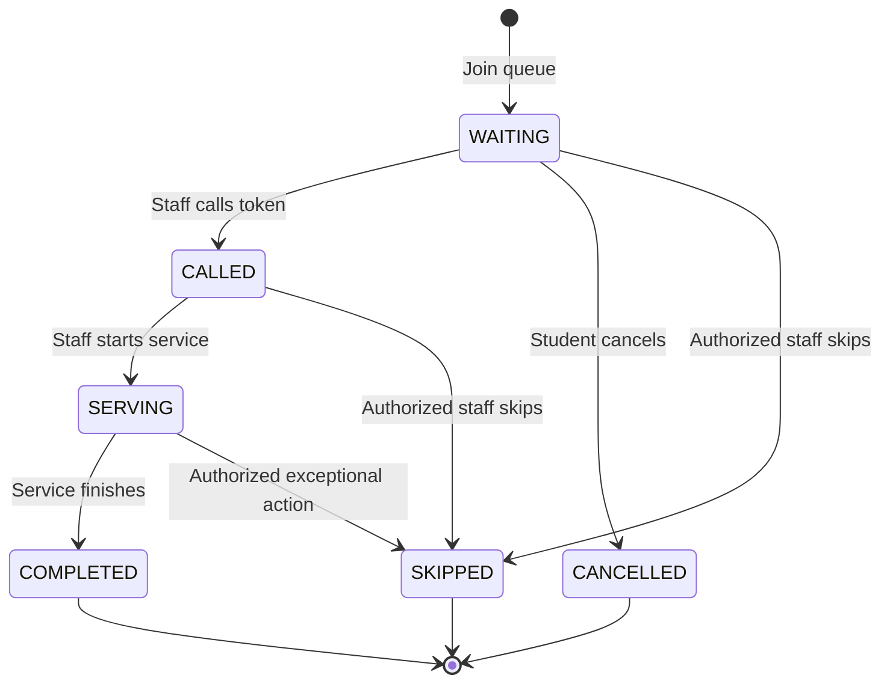

# QueueLess — Complete System Architecture

**Project:** QueueLess — Virtual Queue Management System
**Project type:** University semester project
**Architecture:** Monolithic, server-rendered web application
**Frontend:** EJS, HTML5, CSS3, Bootstrap 5, Vanilla JavaScript
**Backend:** Node.js, Express.js
**Database:** MySQL
**Database driver:** mysql2
**Authentication:** Express sessions with bcrypt password hashing
**Version control:** Git and GitHub
**Development environment:** Windows, VS Code, PowerShell

**Project tagline:** Less Waiting, Better Service.

**Project status:** Architecture and implementation planning.

---

# 1. Project Overview

QueueLess is a web-based Virtual Queue Management System for university service offices. It enables students to join service queues online, receive tokens, track their positions, and estimate how long they may need to wait.

University staff can manage queues, call students, and complete service requests. Administrators can manage services, counters, users, staff assignments, and reports.

The system aims to reduce unnecessary physical waiting, improve queue organization, and provide better visibility into university service operations.

## 1.1 Problem Statement

University offices such as Student Affairs, the Fee Office, Admissions, the Examination Office, IT Support, and Document Verification often experience long queues.

Students may have to stand in line without knowing:

- How many people are ahead of them.
- Which token is currently being served.
- How long they may have to wait.
- Whether a service is currently available.
- Whether their turn has been called.

Staff may also find it difficult to organize queues manually and maintain service records.

QueueLess addresses these problems through a centralized queue management website.

## 1.2 Project Objectives

1. Allow students to join queues online.
2. Generate unique queue tokens.
3. Display current token status and queue position.
4. Calculate estimated waiting time.
5. Allow staff to manage and process queue entries.
6. Allow administrators to manage university services and counters.
7. Maintain queue history.
8. Provide basic operational statistics and reports.
9. Implement secure authentication and role-based authorization.
10. Build a responsive interface that works on desktops, tablets, and mobile devices.

## 1.3 Project Scope

The first release should focus on a reliable queue management workflow.

| Included in the first release | Optional future improvements  |
| ----------------------------- | ----------------------------- |
| Login and registration        | SMS notifications             |
| Role-based dashboards         | Email notifications           |
| Service selection             | Mobile application            |
| Queue token generation        | QR-code check-in              |
| Queue position tracking       | WebSocket updates             |
| Waiting-time estimates        | Advanced predictive analytics |
| Staff queue controls          | Multiple campus support       |
| User and service management   | University ERP integration    |
| Queue history                 | Advanced report exports       |

Do not build optional features before the core queue workflow is working correctly.

---

# 2. System Architecture

QueueLess will use a **monolithic, three-layer application architecture**.

The application is deployed as one Express.js application, with clear separation between the presentation, business logic, and data access layers.

## 2.1 High-Level Architecture



### Request lifecycle

1. A user opens a page in the browser.
2. Express receives the HTTP request.
3. Middleware checks the session and required permissions.
4. A route selects the appropriate controller.
5. The controller calls a business service.
6. The service performs the required operation through the data access layer.
7. The model queries MySQL.
8. The controller renders an EJS template or redirects the user.
9. The browser displays the updated page.

For standard form submissions, use the Post/Redirect/Get pattern where appropriate. Use Fetch API endpoints only for interactions that benefit from partial page updates.

## 2.2 Why This Architecture?

- One application is simpler to develop and deploy for a two-member team.
- EJS integrates directly with Express.
- MySQL provides structured storage and relational integrity.
- Server-side rendering avoids the need for a separate React application.
- Business logic can be tested independently from EJS templates.
- Clear separation makes it easier for another developer or AI to extend the project.

---

# 3. Technology Stack and Responsibilities

| Technology            | Responsibility                                   |
| --------------------- | ------------------------------------------------ |
| HTML5                 | Semantic page structure                          |
| CSS3                  | Custom design system                             |
| Bootstrap 5           | Responsive layout and UI components              |
| Vanilla JavaScript    | Form interactions and queue-status updates       |
| EJS                   | Server-rendered dynamic pages                    |
| Node.js               | JavaScript runtime                               |
| Express.js            | Routing, middleware, and application server      |
| MySQL                 | Persistent application data                      |
| mysql2                | Database connections and parameterized queries   |
| bcrypt                | Password hashing                                 |
| express-session       | Session-based authentication                     |
| express-mysql-session | Persistent sessions in MySQL, if used            |
| dotenv                | Environment configuration                        |
| express-validator     | Request validation                               |
| helmet                | Security-related HTTP headers                    |
| express-rate-limit    | Rate limiting sensitive endpoints                |
| connect-flash         | Optional flash messages for redirects            |
| method-override       | Optional support for PUT/DELETE-style HTML forms |
| Jest and Supertest    | Automated testing                                |

Use only dependencies that are actually needed. Do not install every optional package merely because it appears in this document.

Use Bootstrap Icons or Font Awesome for icons. Chart.js may be added for admin analytics.

---

# 4. Complete Repository Structure

Use the following structure as the target architecture. Keep the existing Git repository and preserve any working files.

```text
QueueLess/
│
├── config/
│   ├── db.js
│   └── session.js
│
├── controllers/
│   ├── authController.js
│   ├── homeController.js
│   ├── studentController.js
│   ├── staffController.js
│   ├── adminController.js
│   ├── serviceController.js
│   ├── queueController.js
│   ├── profileController.js
│   └── errorController.js
│
├── middleware/
│   ├── authMiddleware.js
│   ├── roleMiddleware.js
│   ├── guestMiddleware.js
│   ├── validationMiddleware.js
│   ├── csrfMiddleware.js
│   ├── localsMiddleware.js
│   └── errorMiddleware.js
│
├── models/
│   ├── User.js
│   ├── Service.js
│   ├── Counter.js
│   ├── StaffAssignment.js
│   ├── QueueToken.js
│   ├── QueueHistory.js
│   └── Notification.js
│
├── repositories/
│   ├── userRepository.js
│   ├── serviceRepository.js
│   ├── counterRepository.js
│   ├── assignmentRepository.js
│   ├── queueRepository.js
│   └── reportRepository.js
│
├── services/
│   ├── authService.js
│   ├── queueService.js
│   ├── tokenService.js
│   ├── waitingTimeService.js
│   ├── notificationService.js
│   └── reportService.js
│
├── routes/
│   ├── indexRoutes.js
│   ├── authRoutes.js
│   ├── studentRoutes.js
│   ├── staffRoutes.js
│   ├── adminRoutes.js
│   ├── serviceRoutes.js
│   ├── queueRoutes.js
│   └── apiRoutes.js
│
├── validators/
│   ├── authValidators.js
│   ├── serviceValidators.js
│   ├── queueValidators.js
│   └── userValidators.js
│
├── views/
│   ├── layouts/
│   │   ├── main.ejs
│   │   ├── auth.ejs
│   │   ├── student.ejs
│   │   ├── staff.ejs
│   │   └── admin.ejs
│   │
│   ├── partials/
│   │   ├── public-navbar.ejs
│   │   ├── footer.ejs
│   │   ├── student-sidebar.ejs
│   │   ├── staff-sidebar.ejs
│   │   ├── admin-sidebar.ejs
│   │   ├── topbar.ejs
│   │   ├── flash-messages.ejs
│   │   ├── pagination.ejs
│   │   ├── form-errors.ejs
│   │   └── confirm-modal.ejs
│   │
│   ├── auth/
│   │   ├── login.ejs
│   │   ├── register.ejs
│   │   ├── forgot-password.ejs
│   │   └── reset-password.ejs
│   │
│   ├── student/
│   │   ├── dashboard.ejs
│   │   ├── services.ejs
│   │   ├── queue-status.ejs
│   │   ├── my-queues.ejs
│   │   ├── history.ejs
│   │   └── profile.ejs
│   │
│   ├── staff/
│   │   ├── dashboard.ejs
│   │   ├── queue-management.ejs
│   │   ├── queue-history.ejs
│   │   └── profile.ejs
│   │
│   ├── admin/
│   │   ├── dashboard.ejs
│   │   ├── users.ejs
│   │   ├── user-form.ejs
│   │   ├── services.ejs
│   │   ├── service-form.ejs
│   │   ├── counters.ejs
│   │   ├── counter-form.ejs
│   │   ├── staff-assignments.ejs
│   │   ├── queue-monitor.ejs
│   │   ├── reports.ejs
│   │   └── settings.ejs
│   │
│   ├── errors/
│   │   ├── 403.ejs
│   │   ├── 404.ejs
│   │   └── 500.ejs
│   │
│   ├── home.ejs
│   ├── about.ejs
│   └── contact.ejs
│
├── public/
│   ├── css/
│   │   ├── style.css
│   │   ├── auth.css
│   │   ├── dashboard.css
│   │   └── responsive.css
│   │
│   ├── js/
│   │   ├── main.js
│   │   ├── forms.js
│   │   ├── student.js
│   │   ├── queue-status.js
│   │   ├── staff.js
│   │   └── admin.js
│   │
│   └── images/
│
├── database/
│   ├── schema.sql
│   ├── seed.sql
│   └── migrations/
│
├── docs/
│   ├── ARCHITECTURE.md
│   ├── DATABASE.md
│   ├── API.md
│   ├── UI_DESIGN.md
│   ├── DEVELOPMENT_PLAN.md
│   └── diagrams/
│       ├── system-architecture.mmd
│       ├── er-diagram.mmd
│       └── queue-workflow.mmd
│
├── tests/
│   ├── unit/
│   ├── integration/
│   └── helpers/
│
├── .env.example
├── .gitignore
├── .editorconfig
├── .npmrc
├── app.js
├── server.js
├── package.json
├── package-lock.json
└── README.md
```

## 4.1 Architecture Rules

- `server.js` starts the HTTP server.
- `app.js` configures Express, middleware, views, routes, and error handling.
- `routes/` maps URLs to controllers.
- `controllers/` handles HTTP requests and responses.
- `services/` implements business rules.
- `repositories/` owns database queries.
- `models/` defines the structure and allowed values of entities.
- `middleware/` handles authentication, authorization, validation, and shared request behavior.
- `views/` contains EJS templates.
- `public/` contains browser-accessible assets.
- `database/` contains schema, seed data, and migrations.
- `tests/` contains automated tests.

For a smaller initial implementation, a model may temporarily contain its own SQL queries without a separate repository layer. However, keep queue transaction logic in the service layer and do not put SQL inside controllers or EJS templates.

Do not create empty files for every planned feature and claim the feature is implemented. Add modules when they are needed.

---

# 5. User Roles and Permissions

QueueLess has three primary roles.

## 5.1 Student

A student can:

- Register and log in.
- View available services.
- Join an open service queue.
- View their token and queue position.
- Check the current serving token.
- View estimated waiting time.
- Cancel their own eligible waiting token.
- View their own queue history.
- Update permitted profile information.
- Log out.

A student cannot:

- Call another student's token.
- Complete or skip tokens.
- Manage services or counters.
- View another student's private history.
- Access staff or admin dashboards.

## 5.2 Staff / Counter Operator

A staff member can:

- Log in.
- View assigned services and counters.
- View the queue for an assigned counter.
- Call the next eligible token.
- Start service for a called token.
- Complete service.
- Skip an eligible token.
- Pause or resume a queue when authorized.
- View permitted queue history.
- Update permitted profile information.

A staff member cannot:

- Manage arbitrary users.
- Assign staff to unrelated counters.
- Access administrator settings.
- Modify queue entries belonging to unrelated services or counters.

## 5.3 Administrator

An administrator can:

- View system statistics.
- Create, update, and deactivate services.
- Create and manage counters.
- Create staff accounts or change account roles when authorized.
- Assign staff to services and counters.
- Activate or deactivate user accounts.
- Monitor active queues.
- View system queue history.
- View reports and statistics.
- Configure supported queue settings.

An administrator should not bypass data validation or database constraints simply because they have elevated privileges.

## 5.4 Permission Matrix

| Action                       | Student | Staff           | Admin               |
| ---------------------------- | ------- | --------------- | ------------------- |
| Join a queue                 | Yes     | Optional        | Optional            |
| View own queue               | Yes     | If authorized   | Yes                 |
| Cancel own waiting token     | Yes     | No by default   | Authorized override |
| Call next token              | No      | Assigned queue  | Authorized override |
| Complete service             | No      | Assigned queue  | Authorized override |
| Manage services              | No      | No              | Yes                 |
| Manage counters              | No      | No              | Yes                 |
| Manage staff assignments     | No      | No              | Yes                 |
| Manage user accounts         | No      | No              | Yes                 |
| View system-wide reports     | No      | No              | Yes                 |
| View permitted queue history | Own     | Assigned queues | System-wide         |

Implement these rules in server-side middleware and service logic. Hiding a button in the frontend is not authorization.

---

# 6. Application Routing Architecture

Use server-rendered routes for ordinary page navigation and a small set of JSON endpoints for asynchronous interactions.

## 6.1 Public Routes

| Method | URL                | Purpose                            |
| ------ | ------------------ | ---------------------------------- |
| GET    | `/`                | Homepage                           |
| GET    | `/about`           | About page                         |
| GET    | `/contact`         | Contact page                       |
| POST   | `/contact`         | Submit contact form                |
| GET    | `/login`           | Login page                         |
| POST   | `/login`           | Authenticate user                  |
| GET    | `/register`        | Registration page                  |
| POST   | `/register`        | Create student account             |
| GET    | `/forgot-password` | Password recovery page             |
| POST   | `/forgot-password` | Request password recovery          |
| GET    | `/reset-password`  | Password reset form                |
| POST   | `/reset-password`  | Reset password using a valid token |
| POST   | `/logout`          | End the session                    |

Password recovery may be deferred if the project cannot securely implement token delivery. Do not expose whether an email address belongs to an existing account.

## 6.2 Student Routes

All routes below require student authentication and the student role.

| Method | URL                          | Purpose                         |
| ------ | ---------------------------- | ------------------------------- |
| GET    | `/student/dashboard`         | Student dashboard               |
| GET    | `/student/services`          | Available services              |
| GET    | `/student/queues`            | Active and past queue entries   |
| GET    | `/student/queues/:id`        | Queue details                   |
| POST   | `/student/queues`            | Join a queue                    |
| POST   | `/student/queues/:id/cancel` | Cancel an eligible token        |
| GET    | `/student/history`           | Queue history                   |
| GET    | `/student/profile`           | Profile page                    |
| POST   | `/student/profile`           | Update permitted profile fields |
| POST   | `/student/profile/password`  | Change password                 |

## 6.3 Staff Routes

All routes require staff authentication and authorization for the relevant service or counter.

| Method | URL                         | Purpose                         |
| ------ | --------------------------- | ------------------------------- |
| GET    | `/staff/dashboard`          | Staff dashboard                 |
| GET    | `/staff/queue`              | Queue management page           |
| POST   | `/staff/queue/call-next`    | Call next waiting token         |
| POST   | `/staff/queue/:id/start`    | Start service                   |
| POST   | `/staff/queue/:id/complete` | Complete service                |
| POST   | `/staff/queue/:id/skip`     | Skip an eligible token          |
| POST   | `/staff/queue/pause`        | Pause authorized queue          |
| POST   | `/staff/queue/resume`       | Resume authorized queue         |
| GET    | `/staff/history`            | Assigned queue history          |
| GET    | `/staff/profile`            | Staff profile                   |
| POST   | `/staff/profile`            | Update permitted profile fields |

Every staff action must verify ownership or assignment on the server. Never trust a counter ID supplied by the browser without checking permissions.

## 6.4 Admin Routes

All routes require administrator authorization.

| Method | URL                             | Purpose                        |
| ------ | ------------------------------- | ------------------------------ |
| GET    | `/admin/dashboard`              | Admin overview                 |
| GET    | `/admin/users`                  | User listing                   |
| GET    | `/admin/users/new`              | Create-user form               |
| POST   | `/admin/users`                  | Create authorized user account |
| GET    | `/admin/users/:id/edit`         | Edit-user form                 |
| POST   | `/admin/users/:id/update`       | Update permitted fields        |
| POST   | `/admin/users/:id/status`       | Activate/deactivate user       |
| GET    | `/admin/services`               | Service listing                |
| GET    | `/admin/services/new`           | Create-service form            |
| POST   | `/admin/services`               | Create service                 |
| GET    | `/admin/services/:id/edit`      | Edit-service form              |
| POST   | `/admin/services/:id/update`    | Update service                 |
| POST   | `/admin/services/:id/status`    | Change service availability    |
| GET    | `/admin/counters`               | Counter listing                |
| POST   | `/admin/counters`               | Create counter                 |
| POST   | `/admin/counters/:id/update`    | Update counter                 |
| POST   | `/admin/counters/:id/status`    | Change counter status          |
| GET    | `/admin/assignments`            | Staff assignments              |
| POST   | `/admin/assignments`            | Create staff assignment        |
| POST   | `/admin/assignments/:id/delete` | Remove assignment              |
| GET    | `/admin/queues`                 | System queue monitor           |
| GET    | `/admin/reports`                | Reports and statistics         |
| GET    | `/admin/settings`               | Supported settings page        |
| POST   | `/admin/settings`               | Update validated settings      |

These routes are the target design. Implement them incrementally and document any changes.

## 6.5 JSON Endpoints

Use JSON endpoints only when they improve the experience, such as refreshing queue status without reloading the entire page.

| Method | URL                      | Purpose                                |
| ------ | ------------------------ | -------------------------------------- |
| GET    | `/api/queues/:id/status` | Return authorized queue status         |
| GET    | `/api/services`          | Return available services              |
| GET    | `/api/staff/queue`       | Return current assigned queue data     |
| GET    | `/api/admin/statistics`  | Return authorized dashboard statistics |

JSON endpoints should return consistent response formats and appropriate HTTP status codes. Sensitive information must not be included in the response.

---

# 7. Database Architecture

Use MySQL with InnoDB tables and foreign-key constraints.

The database should enforce referential integrity, while the application service layer enforces queue workflow rules.

## 7.1 Database Name

`queueless_db`

## 7.2 Entity Relationship Diagram



The diagram shows the main relationships. Implement any additional fields or constraints needed by the final design.

---

# 8. Database Table Specifications

## 8.1 `users`

Stores student, staff, and administrator accounts.

| Column          | Type                          | Purpose                     |
| --------------- | ----------------------------- | --------------------------- |
| `id`            | BIGINT, primary key           | User identifier             |
| `full_name`     | VARCHAR(120)                  | Display name                |
| `email`         | VARCHAR(255), unique          | Login email                 |
| `student_id`    | VARCHAR(50), nullable, unique | Student identifier          |
| `password_hash` | VARCHAR(255)                  | Hashed password             |
| `role`          | ENUM                          | `STUDENT`, `STAFF`, `ADMIN` |
| `status`        | ENUM                          | `ACTIVE`, `INACTIVE`        |
| `created_at`    | DATETIME                      | Creation timestamp          |
| `updated_at`    | DATETIME                      | Last update                 |

Rules:

- Never store plaintext passwords.
- Public registration creates student accounts only.
- Staff and administrator account creation requires authorization.
- Use normalized email values when registering and logging in.
- Enforce uniqueness in MySQL, not only in JavaScript.

## 8.2 `services`

Stores the university services students can access.

| Column                    | Type                | Purpose                       |
| ------------------------- | ------------------- | ----------------------------- |
| `id`                      | BIGINT, primary key | Service identifier            |
| `name`                    | VARCHAR(120)        | Service name                  |
| `code`                    | VARCHAR(20), unique | Short service code            |
| `description`             | TEXT                | Service description           |
| `average_service_minutes` | INT                 | Initial waiting-time estimate |
| `is_active`               | BOOLEAN             | Availability                  |
| `created_at`              | DATETIME            | Creation timestamp            |
| `updated_at`              | DATETIME            | Last update                   |

Example services:

- Student Affairs — `SA`
- Fee Office — `FEE`
- Admissions — `ADM`
- Examination Office — `EX`
- IT Support — `IT`
- Document Verification — `DOC`

Service codes should remain stable after tokens have been generated.

## 8.3 `counters`

Represents service desks or counters.

| Column       | Type                | Purpose                    |
| ------------ | ------------------- | -------------------------- |
| `id`         | BIGINT, primary key | Counter identifier         |
| `service_id` | BIGINT, foreign key | Associated service         |
| `name`       | VARCHAR(80)         | Counter name               |
| `status`     | ENUM                | `OPEN`, `CLOSED`, `PAUSED` |
| `created_at` | DATETIME            | Creation timestamp         |
| `updated_at` | DATETIME            | Last update                |

A service may have multiple counters. Queue assignment must respect the service and counter configuration.

## 8.4 `staff_assignments`

Connects staff accounts to authorized counters.

| Column       | Type                | Purpose               |
| ------------ | ------------------- | --------------------- |
| `id`         | BIGINT, primary key | Assignment identifier |
| `user_id`    | BIGINT, foreign key | Staff user            |
| `counter_id` | BIGINT, foreign key | Assigned counter      |
| `created_at` | DATETIME            | Assignment timestamp  |

Prevent duplicate active assignments for the same staff member and counter.

The system must verify these assignments before allowing staff to manage a queue.

## 8.5 `queue_tokens`

This is the most important operational table.

| Column            | Type                         | Purpose                   |
| ----------------- | ---------------------------- | ------------------------- |
| `id`              | BIGINT, primary key          | Internal token ID         |
| `student_id`      | BIGINT, foreign key          | Student who joined        |
| `service_id`      | BIGINT, foreign key          | Selected service          |
| `counter_id`      | BIGINT, nullable foreign key | Assigned counter          |
| `token_number`    | VARCHAR(40)                  | Display token             |
| `queue_date`      | DATE                         | Local queue date          |
| `sequence_number` | INT                          | Sequence within the queue |
| `status`          | ENUM                         | Current token state       |
| `joined_at`       | DATETIME                     | Time joined               |
| `called_at`       | DATETIME, nullable           | Time called               |
| `started_at`      | DATETIME, nullable           | Service start             |
| `completed_at`    | DATETIME, nullable           | Service completion        |
| `cancelled_at`    | DATETIME, nullable           | Cancellation time         |
| `skipped_at`      | DATETIME, nullable           | Skip time                 |
| `created_at`      | DATETIME                     | Record creation           |
| `updated_at`      | DATETIME                     | Last update               |

Use a consistent status vocabulary:

- `WAITING`
- `CALLED`
- `SERVING`
- `COMPLETED`
- `SKIPPED`
- `CANCELLED`

Add appropriate indexes for queue ordering, student history, service filtering, and status lookups.

Use database constraints to prevent duplicate sequence numbers within the relevant queue scope.

## 8.6 `queue_history`

Stores an audit trail of important queue events.

| Column           | Type                         | Purpose                     |
| ---------------- | ---------------------------- | --------------------------- |
| `id`             | BIGINT, primary key          | History identifier          |
| `queue_token_id` | BIGINT, foreign key          | Associated token            |
| `actor_user_id`  | BIGINT, nullable foreign key | User performing action      |
| `action`         | VARCHAR(40)                  | Event type                  |
| `details`        | TEXT, nullable               | Additional safe information |
| `created_at`     | DATETIME                     | Event time                  |

Example events:

- `TOKEN_CREATED`
- `TOKEN_CALLED`
- `SERVICE_STARTED`
- `SERVICE_COMPLETED`
- `TOKEN_SKIPPED`
- `TOKEN_CANCELLED`

Queue history should be append-only through normal application workflows. Do not silently rewrite previous events when a token changes status.

## 8.7 `notifications`

Stores in-app notification records.

| Column       | Type                | Purpose                 |
| ------------ | ------------------- | ----------------------- |
| `id`         | BIGINT, primary key | Notification identifier |
| `user_id`    | BIGINT, foreign key | Recipient               |
| `title`      | VARCHAR(120)        | Notification title      |
| `message`    | TEXT                | Notification message    |
| `read_at`    | DATETIME, nullable  | When read               |
| `created_at` | DATETIME            | Creation time           |

For the first release, notification records can support alerts displayed on the website. Email and SMS delivery are future enhancements.

## 8.8 Additional Data Requirements

If implemented, use an additional settings table for configurable values rather than hardcoding every setting into controllers.

A password-reset implementation should use a separate table for hashed, expiring, single-use reset tokens. Do not store raw password-reset tokens.

---

# 9. Queue Management Business Logic

Queue operations must be implemented in `services/queueService.js`, with supporting database queries in repositories.

Controllers should not independently manipulate token statuses or generate token numbers.

## 9.1 Queue Workflow



Terminal states are `COMPLETED`, `CANCELLED`, and `SKIPPED`. Normal workflows must not move a terminal token back into `WAITING`.

A token can be called only when its queue is eligible to serve it. A counter should not start two active services simultaneously unless concurrent service is explicitly supported.

## 9.2 Joining a Queue

When a student submits a join request:

1. Verify the session and student role.
2. Validate the requested service ID.
3. Verify that the service is active.
4. Verify that at least one appropriate counter is open.
5. Check whether the student already has an active token for that service.
6. Begin a MySQL transaction.
7. Allocate the next sequence number safely.
8. Create the token with `WAITING` status.
9. Add a `TOKEN_CREATED` history record.
10. Commit the transaction.
11. Redirect the student to the queue-status page.

If any step fails, roll back the transaction.

Do not allocate sequence numbers using an unsafe pattern such as reading the maximum number and incrementing it outside a transaction. Use a transaction and a locked sequence record, or another concurrency-safe allocation mechanism.

## 9.3 Token Generation

Example display tokens:

- `SA-001`
- `FEE-014`
- `EX-042`
- `IT-008`

The internal numeric database ID must not be treated as the display token.

Define token uniqueness clearly. For example, sequence numbers may reset daily for each service, with a unique key on `(service_id, queue_date, sequence_number)`.

If multiple counters share a service queue, use one sequence per service and date. Counter assignment and serving order must follow the queue's defined policy.

## 9.4 Queue Position

For a waiting token, calculate its position using eligible tokens ahead of it in the same service queue, ordered by sequence number.

A simple definition is:

`Position = Number of eligible waiting tokens ahead + 1`

The number of people ahead is:

`People ahead = max(Position - 1, 0)`

Tokens that are cancelled, skipped, completed, or otherwise no longer eligible to wait must not count as people ahead.

If the queue supports multiple counters, the implementation must clearly define whether position is calculated across the shared service queue or only for an assigned counter. Prefer a shared service-level waiting queue when students are not assigned a counter at join time.

## 9.5 Calling the Next Token

1. Verify staff authorization for the counter.
2. Start a database transaction.
3. Lock the relevant queue/counter state.
4. Ensure the counter is open and not paused.
5. Ensure there is no active token already being served at that counter.
6. Select the earliest eligible waiting token.
7. Change its status to `CALLED`.
8. Set `called_at`.
9. Record `TOKEN_CALLED` in queue history.
10. Commit the transaction.
11. Return or render the updated queue state.

Use appropriate row locking and indexes to prevent concurrent staff requests from calling the same token twice.

## 9.6 Starting and Completing Service

Starting service:

- Only an authorized staff member can perform the action.
- The token must be in `CALLED` status.
- The counter must be available.
- Change status to `SERVING`.
- Set `started_at`.
- Record `SERVICE_STARTED`.

Completing service:

- The token must be in `SERVING` status.
- Change status to `COMPLETED`.
- Set `completed_at`.
- Record `SERVICE_COMPLETED`.
- Make the counter available for its next token.
- Update any calculated statistics using the actual completed-service duration.

All related database changes must be consistent and transaction-safe.

## 9.7 Cancellation

A student can cancel their own token while it is `WAITING`.

The application must verify token ownership, update the status, record the cancellation time, and write a history event.

Do not allow ordinary student cancellation after the token has been called or service has started.

If an administrator override is later introduced, it must be explicitly authorized and audited.

## 9.8 Skipping a Token

Staff may skip an eligible called or waiting token according to the agreed queue policy.

The operation must:

- Verify the staff member's assignment.
- Verify the token's current status.
- Update the status to `SKIPPED`.
- Set `skipped_at`.
- Record the reason if required by the policy.
- Add a history event.
- Make the next token eligible when appropriate.

The UI should explain what skipping means and request confirmation where appropriate.

## 9.9 Pausing and Resuming

A paused queue must not accept normal serving actions.

Define whether students can still join a paused queue. The default recommendation is:

- Students cannot join a queue if its service or all appropriate counters are unavailable.
- A pause on an individual counter prevents that counter from calling new tokens.
- Existing in-progress services may be allowed to finish.
- The interface clearly explains the queue's current availability.

Do not rely only on a frontend button to enforce these rules.

---

# 10. Waiting-Time Calculation

Start with a simple and explainable estimate.

Let:

- (P) = number of eligible people ahead.
- (T) = estimated average service time in minutes.
- (C) = number of active counters effectively serving the same queue.

For a single counter:

[
\text{Estimated Wait} = P \times T
]

For multiple counters, a rough estimate may be:

[
\text{Estimated Wait} \approx
\left\lceil \frac{P}{C} \right\rceil \times T
]

However, the multiple-counter formula is only an approximation. It assumes similar service times and that all counters serve the same queue. A more accurate implementation should consider active services and each counter's workload.

Initially, use `average_service_minutes` from the service configuration. Once enough completed-service data exists, calculate an average from recent completed tokens.

Display the estimate as approximate, not guaranteed.

Example:

- People ahead: 4
- Average service time: 5 minutes
- One serving counter
- Estimated wait: approximately 20 minutes

Handle missing data, zero active counters, and paused queues explicitly.

---

# 11. Authentication and Session Management

Use server-side sessions because QueueLess is primarily an EJS-rendered application.

## 11.1 Login Workflow

1. Accept email and password.
2. Normalize and validate the email.
3. Find the account by email.
4. Verify that the account is active.
5. Compare the submitted password with the stored bcrypt hash.
6. Regenerate the session ID after successful authentication.
7. Store only the minimum necessary user identity and role in the session.
8. Redirect to the appropriate role dashboard.

Example role destinations:

- Student → `/student/dashboard`
- Staff → `/staff/dashboard`
- Admin → `/admin/dashboard`

Do not trust a role submitted from a registration form or client-side JavaScript.

## 11.2 Middleware Responsibilities

`authMiddleware.js`

- Check whether the user has an authenticated session.
- Redirect unauthenticated users to login.

`roleMiddleware.js`

- Restrict routes to permitted roles.
- Reject unauthorized access even if a user enters a URL manually.

`guestMiddleware.js`

- Redirect authenticated users away from login and registration pages when appropriate.

`validationMiddleware.js`

- Handle validation failures consistently.

`csrfMiddleware.js`

- Protect state-changing form submissions against cross-site request forgery.

`localsMiddleware.js`

- Expose safe user information and flash messages to EJS templates.

`errorMiddleware.js`

- Handle unexpected errors without exposing internal details.

## 11.3 Session Security

- Use a persistent session store such as MySQL in production.
- Do not use the default in-memory session store for production deployment.
- Set a strong session secret using environment variables.
- Enable `httpOnly` and appropriate `sameSite` cookie settings.
- Enable `secure` cookies when deployed over HTTPS.
- Set sensible session expiration and logout behavior.
- Regenerate the session after login and privilege changes.
- Destroy the session on logout.
- Protect all state-changing requests with CSRF tokens.

---

# 12. EJS Frontend Architecture

Use server-rendered EJS pages with reusable layouts and partials.

## 12.1 Layouts

`views/layouts/main.ejs`

Public pages use the public navigation and footer.

`views/layouts/auth.ejs`

Login and registration pages use a minimal authentication layout.

`views/layouts/student.ejs`

Student pages use the student sidebar, topbar, and main content area.

`views/layouts/staff.ejs`

Staff pages use the staff-specific navigation.

`views/layouts/admin.ejs`

Admin pages use the administrator sidebar and dashboard shell.

If you use EJS layouts, select a compatible layout package or implement layouts using standard EJS includes. Standard EJS does not provide an automatic layout system by itself.

## 12.2 Visual Design System

Use a consistent design system.

| Element         | Recommended design |
| --------------- | ------------------ |
| Primary blue    | `#2563EB`          |
| Dark navy       | `#14213D`          |
| Page background | `#F5F7FB`          |
| Card background | `#FFFFFF`          |
| Main text       | `#1E293B`          |
| Secondary text  | `#64748B`          |
| Border          | `#E2E8F0`          |
| Success         | `#16A34A`          |
| Warning         | `#F59E0B`          |
| Danger          | `#DC2626`          |

The UI should include:

- Consistent typography and spacing.
- Reusable buttons, badges, tables, and forms.
- Responsive dashboard layouts.
- Accessible forms and validation messages.
- Useful empty states.
- Loading and error states.
- Confirmation dialogs for important actions.
- Clear distinction between students, staff, and administrators.

Do not repeat large blocks of HTML across every page.

## 12.3 Rendering Dynamic Data

Example controller:

```javascript
async function dashboard(req, res, next) {
    try {
        const summary = await studentService.getDashboardSummary(
            req.session.user.id
        );

        res.render("student/dashboard", {
            title: "Student Dashboard",
            summary
        });
    } catch (error) {
        next(error);
    }
}
```

The EJS template should display values passed by the controller. It should not query the database or implement business logic.

Use EJS's escaped output syntax for ordinary user-provided text. Avoid rendering untrusted values using unescaped EJS output.

---

# 13. Controller, Service, and Repository Responsibilities

## 13.1 Controllers

Controllers handle HTTP requests and responses.

Example: `queueController.js`

- Read route parameters and validated request values.
- Call the appropriate service function.
- Render a view or redirect.
- Return JSON for explicitly asynchronous endpoints.
- Forward unexpected errors to Express error middleware.

Controllers must not contain complicated SQL or independently implement queue business rules.

## 13.2 Services

Services implement business logic.

Example: `queueService.js`

- Validate queue eligibility.
- Enforce token state transitions.
- Create tokens.
- Call and complete tokens.
- Cancel and skip tokens.
- Enforce transaction boundaries.
- Record queue history.
- Calculate queue position and waiting time.

## 13.3 Repositories

Repositories own SQL queries.

Example: `queueRepository.js`

- Retrieve queue entries.
- Lock rows where necessary.
- Insert and update queue records.
- Retrieve current queue state.
- Query history and reports.

Use parameterized queries rather than building SQL strings from user input.

## 13.4 Models

Models define the data structure and allowed values of entities. In a lightweight mysql2 implementation, models may contain constants, entity definitions, and data-related helper methods.

Do not mix EJS rendering with model operations.

---

# 14. Request Validation and Error Handling

Validate all incoming data on the server.

Examples:

- Email format.
- Password length and confirmation.
- Valid service and counter IDs.
- Valid queue token IDs.
- Valid enum values.
- Pagination bounds.
- Search input length.
- Role permissions.
- Account status.

Never assume that client-side validation is sufficient.

Use consistent HTTP behavior:

| Situation                 | Expected response    |
| ------------------------- | -------------------- |
| Successful page request   | HTTP 200             |
| Successful creation       | Redirect or HTTP 201 |
| Invalid input             | HTTP 400             |
| Unauthenticated request   | Redirect or HTTP 401 |
| Unauthorized role         | HTTP 403             |
| Missing resource          | HTTP 404             |
| Invalid state transition  | HTTP 409             |
| Unexpected server failure | HTTP 500             |

For server-rendered forms, show understandable validation messages. For JSON endpoints, return a consistent JSON structure.

Example:

```json
{
  "success": false,
  "message": "This queue entry can no longer be cancelled."
}
```

Do not send stack traces, SQL errors, passwords, session identifiers, or internal secrets to the browser.

---

# 15. Frontend Page Inventory

## 15.1 Public Pages

| Page     | Template            |
| -------- | ------------------- |
| Homepage | `views/home.ejs`    |
| About    | `views/about.ejs`   |
| Contact  | `views/contact.ejs` |

## 15.2 Authentication Pages

| Page            | Template                         |
| --------------- | -------------------------------- |
| Login           | `views/auth/login.ejs`           |
| Register        | `views/auth/register.ejs`        |
| Forgot password | `views/auth/forgot-password.ejs` |
| Reset password  | `views/auth/reset-password.ejs`  |

## 15.3 Student Pages

| Page               | Template                         |
| ------------------ | -------------------------------- |
| Dashboard          | `views/student/dashboard.ejs`    |
| Available services | `views/student/services.ejs`     |
| Queue status       | `views/student/queue-status.ejs` |
| My queues          | `views/student/my-queues.ejs`    |
| Queue history      | `views/student/history.ejs`      |
| Profile            | `views/student/profile.ejs`      |

## 15.4 Staff Pages

| Page             | Template                           |
| ---------------- | ---------------------------------- |
| Dashboard        | `views/staff/dashboard.ejs`        |
| Queue management | `views/staff/queue-management.ejs` |
| Queue history    | `views/staff/queue-history.ejs`    |
| Profile          | `views/staff/profile.ejs`          |

## 15.5 Admin Pages

| Page               | Template                            |
| ------------------ | ----------------------------------- |
| Dashboard          | `views/admin/dashboard.ejs`         |
| User management    | `views/admin/users.ejs`             |
| User form          | `views/admin/user-form.ejs`         |
| Service management | `views/admin/services.ejs`          |
| Service form       | `views/admin/service-form.ejs`      |
| Counter management | `views/admin/counters.ejs`          |
| Counter form       | `views/admin/counter-form.ejs`      |
| Staff assignments  | `views/admin/staff-assignments.ejs` |
| Queue monitor      | `views/admin/queue-monitor.ejs`     |
| Reports            | `views/admin/reports.ejs`           |
| Settings           | `views/admin/settings.ejs`          |

## 15.6 Error Pages

- 403 Access Denied
- 404 Page Not Found
- 500 Server Error

Each page must use the correct layout, authorization rules, and data supplied by its controller.

---

# 16. Environment and Configuration

Create `.env.example` in the project root.

Example:

```env
NODE_ENV=development
PORT=3000

DB_HOST=localhost
DB_PORT=3306
DB_USER=root
DB_PASSWORD=
DB_NAME=queueless_db
DB_CONNECTION_LIMIT=10

SESSION_SECRET=replace_with_a_long_random_secret
SESSION_MAX_AGE_MS=28800000
```

Use your actual local MySQL configuration in `.env`.

Rules:

- Never commit `.env`.
- Commit `.env.example` without real credentials.
- Validate required environment variables at startup.
- Use a connection pool.
- Handle database connection errors safely.
- Do not print passwords or session secrets in logs.

The application should fail with a clear startup error if critical configuration is missing.

---

# 17. Core Application Files

## `server.js`

Responsibilities:

- Import the configured Express application.
- Start the HTTP server.
- Listen on the configured port.
- Handle startup errors.
- Optionally manage graceful shutdown.

## `app.js`

Responsibilities:

- Create the Express application.
- Configure EJS.
- Configure static file serving.
- Configure body parsing.
- Configure sessions.
- Configure security middleware.
- Register routes.
- Register not-found handling.
- Register centralized error handling.

Do not put all application logic inside `server.js`.

## `config/db.js`

Responsibilities:

- Create the MySQL connection pool.
- Read database settings from environment variables.
- Export the pool or a controlled database interface.

## `config/session.js`

Responsibilities:

- Configure the session middleware.
- Configure the persistent session store.
- Set appropriate cookie options.
- Export the configured middleware.

## `database/schema.sql`

Responsibilities:

- Create the required tables.
- Define primary and foreign keys.
- Define indexes and unique constraints.
- Define data types and default values.

## `database/seed.sql`

Responsibilities:

- Insert optional sample services.
- Insert development-only sample records where appropriate.
- Avoid hardcoded production passwords.
- Keep sample data separate from schema creation.

---

# 18. API and Form Interaction Conventions

Prefer standard HTML forms for actions that naturally navigate to a new page.

Examples:

- Login.
- Registration.
- Join queue.
- Cancel queue.
- Create a service.
- Update a counter.
- Complete a token.

Use Fetch API for interactions that benefit from updating a portion of the page.

Examples:

- Refresh queue position.
- Refresh current serving token.
- Refresh staff queue data.
- Refresh admin dashboard statistics.

For JSON endpoints, use a consistent response format:

Success:

```json
{
  "success": true,
  "message": "Queue status retrieved.",
  "data": {}
}
```

Failure:

```json
{
  "success": false,
  "message": "Unable to retrieve queue status."
}
```

The `data` object must contain only the fields required by the caller.

All state-changing requests must use appropriate authentication, authorization, validation, and CSRF protection. GET requests must not perform state-changing operations.

---

# 19. Security Requirements

Security is part of the architecture, not a final optional step.

Implement the following:

1. Password hashing with bcrypt.
2. Server-side session authentication.
3. Role-based access control.
4. Resource ownership checks.
5. CSRF protection for state-changing requests.
6. Parameterized SQL queries.
7. Server-side input validation.
8. Safe EJS output escaping.
9. Secure session cookie configuration.
10. Rate limiting on login and other sensitive endpoints.
11. Security headers through Helmet.
12. Generic error messages for unexpected failures.
13. Protection against mass assignment of sensitive fields.
14. Transaction-safe queue operations.
15. Database constraints for uniqueness and relationships.
16. Auditable staff queue actions.
17. Secrets excluded from Git.
18. Account status checks during authorization.

Do not let students set their own roles. Do not rely on hiding restricted navigation items to secure a route.

---

# 20. Testing Architecture

Use Jest and Supertest for automated tests where practical.

## 20.1 Unit Tests

Test individual business functions:

- Token status transitions.
- Queue position calculations.
- Waiting-time calculations.
- Input validation.
- Permission checks.

## 20.2 Integration Tests

Test interactions between controllers, services, and MySQL:

- Student registration.
- Login and logout.
- Queue joining.
- Queue cancellation.
- Calling the next token.
- Starting and completing service.
- Unauthorized queue access.
- Duplicate token prevention.
- Transaction rollback on failures.

## 20.3 Manual UI Tests

Verify:

- Every page renders.
- All internal links work.
- EJS includes resolve correctly.
- Forms display validation messages.
- Dashboards show the correct role-specific information.
- The queue status page refreshes correctly.
- Staff actions update the queue consistently.
- The admin can manage services and counters.
- Empty states display properly.
- The UI works on desktop and mobile.

Use a separate test database. Never run destructive integration tests against important real data.

---

# 21. GitHub Collaboration Architecture

The project has two team members. Use one shared repository and feature branches.

## Branching strategy

- `main` — stable code.
- `feature/authentication` — login, registration, sessions.
- `feature/student-dashboard` — student pages.
- `feature/queue-management` — token generation and queue logic.
- `feature/staff-dashboard` — staff queue controls.
- `feature/admin-dashboard` — admin management pages.
- `feature/database` — schema and database setup.

Create branches only as needed. Avoid maintaining many branches that duplicate work or remain unused.

## Workflow

1. Create a GitHub issue describing the task.
2. Create a feature branch from the latest `main`.
3. Implement one well-defined feature.
4. Test the change locally.
5. Commit with a clear message.
6. Push the branch.
7. Open a pull request.
8. Review the changes.
9. Merge after resolving conflicts and confirming the feature works.

Example commits:

- `feat: add student registration`
- `feat: implement queue token creation`
- `feat: add staff queue controls`
- `fix: prevent duplicate active tokens`
- `style: improve student dashboard layout`
- `docs: document database schema`

Never commit `.env`, credentials, `node_modules`, or generated secret files.

---

# 22. Recommended Team Division

For two developers, divide the work by feature ownership rather than making both developers independently modify every file.

## Developer A — Backend and Database

Primary responsibilities:

- MySQL schema and seed data.
- Database connection.
- Authentication and sessions.
- Models and repositories.
- Queue business logic.
- Queue transactions and token generation.
- Staff operations.
- Admin business logic.
- Backend tests.

## Developer B — EJS Frontend and UI/UX

Primary responsibilities:

- Design system.
- Public pages.
- Authentication templates.
- Student dashboard.
- Queue status page.
- Staff dashboard UI.
- Admin dashboard UI.
- Responsive CSS.
- Frontend interactions.
- UI testing.

## Shared responsibilities

Both developers should coordinate on:

- Route names.
- Controller expectations.
- EJS variable names.
- Form field names.
- Database column names.
- Queue status definitions.
- Error messages.
- Integration testing.
- Pull request reviews.

**Important:** The frontend developer must not guess the backend contract. Agree on request fields, route paths, and response data before integrating each feature.

---

# 23. Implementation Roadmap

Build QueueLess in the following order.

## Phase 1 — Project Foundation

- Initialize the repository.
- Create the Express application.
- Configure EJS.
- Configure static files.
- Configure environment variables.
- Connect to MySQL.
- Create the initial schema.
- Add basic error handling.
- Verify the homepage renders.

**Completion condition:** The application starts and connects to the database.

## Phase 2 — Authentication and Authorization

- Implement registration.
- Implement login.
- Hash passwords.
- Configure sessions.
- Add logout.
- Implement authentication middleware.
- Implement role middleware.
- Create role-specific dashboard placeholders.

**Completion condition:** Each role can log in and access only authorized pages.

## Phase 3 — Public and Shared UI

- Implement the design system.
- Build the public navbar and footer.
- Build the authentication layout.
- Build responsive dashboard layouts.
- Add shared form and alert components.

**Completion condition:** The UI has consistent reusable layouts.

## Phase 4 — Services and Counters

- Create service management.
- Create counter management.
- Add staff assignments.
- Validate service availability.
- Display services to students.

**Completion condition:** Administrators can configure services and counters, and students can see available services.

## Phase 5 — Core Queue Workflow

- Generate tokens.
- Join a queue.
- Calculate queue position.
- Estimate waiting time.
- Cancel eligible tokens.
- Call the next token.
- Start and complete service.
- Skip tokens.
- Pause and resume queues.
- Record queue history.

**Completion condition:** A student can join a queue and a staff member can process the token from beginning to end.

## Phase 6 — Dashboards and History

- Implement student dashboard.
- Implement queue-status page.
- Implement staff dashboard.
- Implement admin dashboard.
- Implement queue history.
- Add basic analytics.

**Completion condition:** Each role can see relevant operational data.

## Phase 7 — Testing and Security

- Test all roles.
- Test invalid input.
- Test unauthorized access.
- Test duplicate requests.
- Test queue state transitions.
- Verify CSRF protection.
- Verify responsive behavior.
- Verify error handling.

**Completion condition:** The main workflows work correctly and security checks pass.

## Phase 8 — Documentation and Deployment Preparation

- Complete README.
- Document the database.
- Document routes and forms.
- Add setup instructions.
- Prepare sample data.
- Verify environment configuration.
- Prepare deployment configuration if required.

**Completion condition:** Another developer can clone the repository and follow the documented setup process.

---

# 24. Definition of Done

QueueLess is ready for demonstration when all of the following are true:

- [x] The application runs locally.
- [x] The MySQL database can be initialized.
- [x] A student can register and log in.
- [x] Staff and admin accounts can authenticate securely.
- [x] Role-based access works.
- [x] Students can view available services.
- [x] Students can join a queue and receive a token.
- [x] Queue position is calculated correctly.
- [x] Waiting time is presented as an estimate.
- [x] Students can cancel eligible tokens.
- [x] Staff can call, start, complete, and skip tokens according to the workflow.
- [x] Paused and unavailable queues are handled correctly.
- [x] Queue history is recorded.
- [x] Administrators can manage services and counters.
- [x] Staff assignments are enforced.
- [x] Dashboard data comes from the database.
- [x] Forms are validated.
- [x] State-changing actions are protected.
- [x] Queue operations handle concurrent requests safely.
- [x] EJS templates render without errors.
- [x] The interface is responsive.
- [x] The README contains working setup instructions.
- [x] No credentials are committed to GitHub.

---

# 25. Instructions for Any AI Working on This Repository

When an AI coding assistant receives this project, it must follow these rules.

## Before changing code

1. Inspect the existing repository and its Git status.
2. Read `README.md`, `package.json`, and the existing source files.
3. Inspect the database schema and current routes.
4. Identify what is implemented and what is missing.
5. Preserve working functionality.
6. Ask for clarification only when a genuine architectural decision cannot be resolved from the repository and this document.

## While implementing

1. Use Node.js, Express.js, EJS, Bootstrap, Vanilla JavaScript, and MySQL.
2. Do not introduce React, Next.js, or Tailwind CSS.
3. Follow the established folder structure unless a justified change is necessary.
4. Reuse existing middleware, layouts, partials, services, and repositories.
5. Keep business logic out of EJS templates.
6. Keep SQL queries out of controllers.
7. Validate all user input on the server.
8. Enforce authorization on every protected operation.
9. Use database transactions for multi-step queue operations.
10. Keep frontend request fields and backend expectations consistent.
11. Avoid fake success messages and hardcoded production data.
12. Do not delete or overwrite existing files without understanding their purpose.
13. Add tests for important business rules.
14. Update the documentation when routes, schema, or configuration change.

## Before declaring completion

- Run the relevant tests.
- Start the application if the environment allows it.
- Verify the affected routes and EJS templates.
- Check for missing dependencies.
- Check for syntax errors.
- Report any failures honestly.
- List files created, modified, and deleted.
- Provide exact commands to run the feature.
- Identify any remaining work.

Never claim that a feature has been tested if it has not been tested.

---

# 26. Suggested Documentation Files

Keep the following files in `docs/`:

- `ARCHITECTURE.md` — Overall application structure and design decisions.
- `DATABASE.md` — Tables, relationships, constraints, and queue rules.
- `API.md` — Routes, request fields, response formats, and permissions.
- `UI_DESIGN.md` — Colors, typography, page layouts, and reusable components.
- `DEVELOPMENT_PLAN.md` — Milestones, task ownership, and implementation status.

This document can be saved as `docs/ARCHITECTURE.md`. Shorter specialized documents can be created from it as implementation proceeds.

---

# 27. Final Architecture Principle

QueueLess should be developed as a **single, modular Express.js application with EJS-rendered pages and a MySQL database**.

The frontend, backend, and database must follow one shared contract:

- EJS templates display data.
- Controllers handle HTTP requests.
- Services enforce business rules.
- Repositories execute database queries.
- MySQL stores persistent data and enforces relational constraints.
- Middleware protects routes and actions.
- Tests verify that the system behaves correctly.

The most important feature is not the dashboard design by itself. It is the complete queue lifecycle:

**Student joins queue → Token is generated → Position is calculated → Staff calls token → Service begins → Service completes → History is recorded.**

Build and test this workflow before adding optional features. A smaller, reliable system is better than a large interface whose buttons do not work.

**End of architecture document.**
